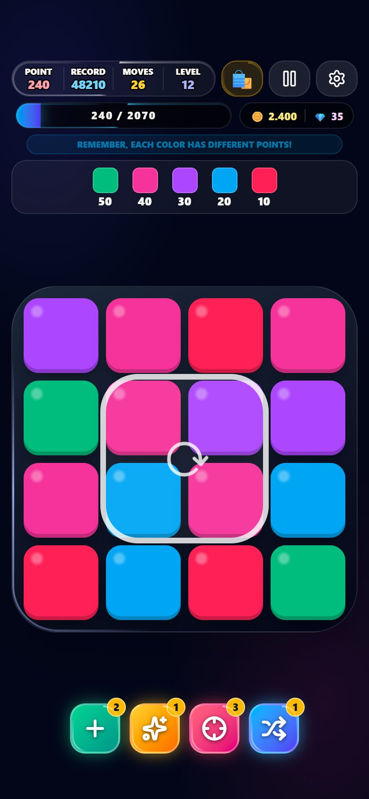
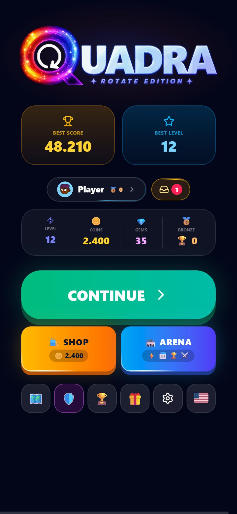
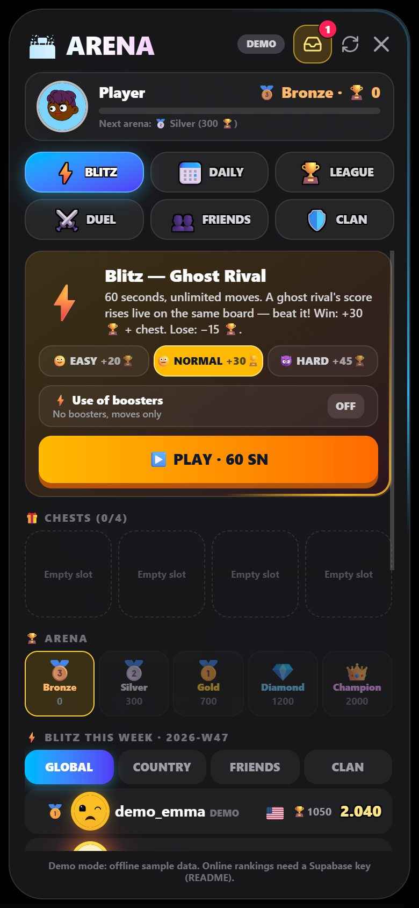
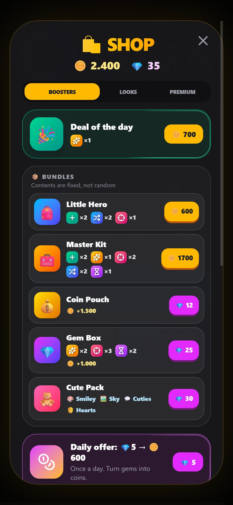
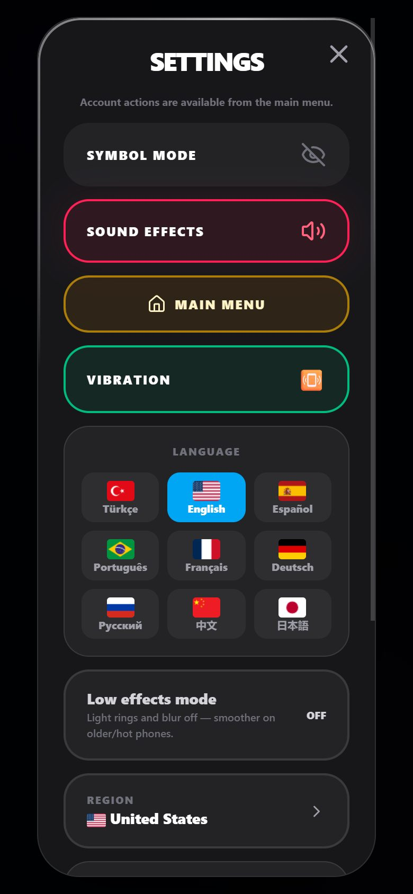

# Quadra Rotate

**A color-matching puzzle game where you rotate the board, not the pieces. Live on Google Play.**

Most match-3 games let you swap two tiles. In Quadra Rotate you pick any 2×2 square on the board and turn it a quarter clockwise. Four blocks move at once, so every move changes the board in ways that are easy to try and hard to master. Line up three of a color, or a 2×2 square, and they clear.

I built it on my own, from the game rules to the online modes, and shipped it to Google Play.

> This repository is a showcase. The source code is private.

  <a href="https://play.google.com/store/apps/details?id=con.derbar.quadra"><b>Get it on Google Play</b></a>

  
  
  
  
  

Screenshots are from the game's offline demo mode. Player names in the rankings are made-up sample data.

## How it plays

- **Rotate, don't swap.** Tap a 2×2 square to turn it. Hard levels use a 3×3 frame.
- **Every color is worth something different.** The point table changes per level, so the best move is not always the obvious one.
- **Chains and combos.** Cleared blocks fall, new ones drop in, and chain reactions build a combo multiplier. Matching four or more blocks at once multiplies the points and gives back moves.
- **The board grows with you,** from 4×4 in the first levels up to 10×10 later on, with more colors as you go.
- **Events that break the routine:** bomb rounds where three bombs race a timer, treasure levels and boss levels.
- **Boosters** for when you're stuck: extra moves, double points, a color bomb and a reshuffle that redistributes the blocks.
- Stars, a level map to replay old levels, achievements and a daily reward.

## Arena: playing against people

- **Blitz:** 60 seconds, unlimited moves, against a "ghost" rival whose score rises live on the same board.
- **Daily challenge:** everyone gets the same board each day.
- **Weekly league, trophies and arena tiers** from Bronze to Champion, plus chests to open.
- **Live duels:** two players take turns on one shared board in real time.
- **Friends and clans,** with a clan score and weekly clan wars.
- Optional account linking and cloud save, so progress survives a new phone.

## Made for everyone

- Nine languages: English, Turkish, Spanish, Portuguese, French, German, Russian, Chinese and Japanese.
- **Symbol mode** puts a symbol on every color, for players who find colors hard to tell apart.
- Three text sizes, and a layout that fits screens from small phones to tablets without scrolling.
- A **low effects mode** that also switches on by itself when a device starts to struggle.
- An age screen at first launch. Younger players get child-safe ad settings, and account linking is turned off for them.

## How it's built

| | |
|---|---|
| App | React 19, Vite, Tailwind CSS 4 |
| Android | Capacitor 8 |
| Backend | Supabase: Postgres, Auth and Realtime |
| Monetization | Google AdMob (rewarded and interstitial ads), Google Play Billing |
| Hosting | Vercel for the web build, privacy policy and terms |
| Testing | Headless-browser end-to-end tests, a two-client duel sync test, a layout overflow scan across screen sizes and languages, and a level balance simulator |

A few things I cared about:
- **The game works fully offline.** Without a connection the online features switch to a demo backend with local sample data, so nothing breaks on a plane.
- **Duels stay in sync.** Both players get the same deterministic board from a shared seed, and moves are replayed in order on both sides. A test runs two real clients side by side and checks that boards and scores match after every move.
- **Level targets come from a simulation.** A script plays many simulated games with different bot strategies to tune how hard each level is.
- **One look across the game:** dark background, bright blocks, and a slow rotating light frame instead of flashing effects.

## Status

- [x] Live on Google Play
- [x] Core game, events, boosters, map and achievements
- [x] Arena: Blitz, daily challenge, league, duels, friends and clans
- [x] Nine languages, symbol mode and low effects mode
- [ ] Server-side purchase validation
- [ ] Seasonal league with fixed fixtures

## License

Copyright (c) 2026 Baris Alkan. All rights reserved. The game, its name, the text and the images in this repository may not be copied, modified or reused without my written permission. See [LICENSE](LICENSE).
